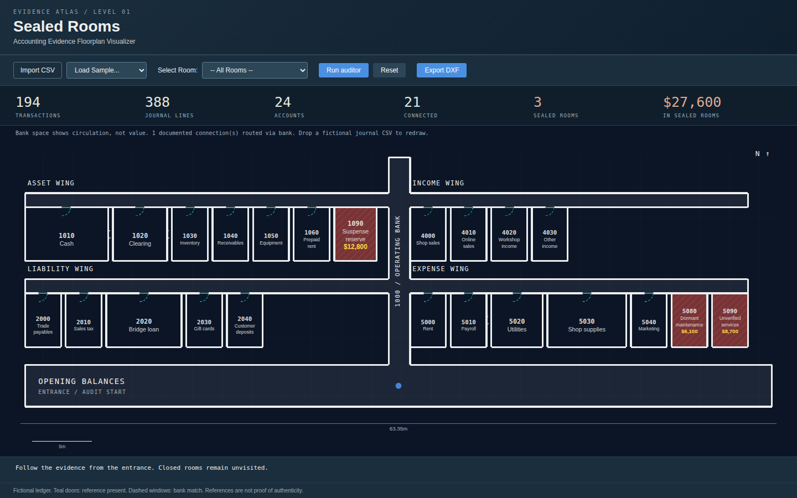

# Sealed Rooms

Sealed Rooms turns a double-entry journal into a floor plan so bookkeepers and small finance teams can see which accounts have no evidence path back to the operating bank. Each account is a room. References form doorways, and rooms the auditor cannot reach are marked as sealed.

**Kiroween 2026 · Frankenstein** combines accounting journal entries and CAD floor plans. The same ledger drives an interactive browser walkthrough and a DXF drawing.



## Try it

Live demo: https://kks0488.github.io/sealed-rooms/ (runs entirely in your browser; all ledger data in this repository is fictional).

Use Node.js 22 and npm 10 (verified with Node.js 22.22.1 and npm 10.9.4). Run these commands from the repository root. The app has no packages to install.

```bash
npm run build
npm run dev
```

Open the local address printed by the server. The original fictional journal loads on startup. Select a room to see its entries and references, then choose **Run auditor** to follow the evidence paths from the entrance. The original sample has three sealed rooms with $27,600 in entries to review. Choose **Evidence repaired** to see the same sample with its missing references filled in. Use **Export DXF** to download the current drawing. [Room details screenshot](artifacts/03-room-details.png)

You can also drop a journal CSV into the page. The header is `transaction,date,account,debit_cents,credit_cents,evidence,memo`. Each transaction ID has a debit row and a credit row with matching dates, amounts, evidence references, and memos. The bundled `journal.csv` contains 194 transactions across 388 data rows and 24 accounts. The parser supports quoted commas and embedded newlines. CSV parsing and DXF export run in the browser. Any static HTTP host can serve the files in `dist/`.

## How the plan works

The operating bank is the central corridor, opening balances are the entrance, and rooms are arranged in asset, liability, income, and expense wings. Room size reflects gross activity, with a minimum size to keep small accounts readable. The auditor follows evidence-bearing paths from the bank and summarizes the accounts it could not reach. A supplied reference is treated as a reference only. The app does not verify the underlying document. The sample bank-statement matches are fictional.

The DXF contains walls, door openings and swings, room labels, and sealed-room outlines at 50 mm per plan unit. One layout connection, Cash to Clearing, is routed through bank circulation. The plan prioritizes bank-rooted reachability over a direct doorway for every account pairing.

## How we used Kiro

Kiro CLI 3.3.0 produced the requirements, design, and implementation tasks in `.kiro/specs/sealed-rooms/`. We used the spec to work through ledger validation and evidence reachability, room geometry and DXF export, then the browser and auditor walkthrough. Later Kiro tasks corrected DXF text placement, label fit and orientation. In task 8, Kiro added door swings, sealed-room hatching, and plan centering before reaching its monthly limit.

The product, technology, and structure steering files kept us working with fictional data, running locally, and using the plan’s door openings for the auditor’s path. The `PostFileSave` hook runs `npm test` when Kiro saves JavaScript under `src/` or `test/`. The repository includes 11 recorded hook runs in `artifacts/hook-events.jsonl`.

We started from our November 17 proof of concept, made outside Kiro during the submission period. We reused its design concept and copied two fictional data files, `fixture.json` and `journal.csv`. We copied no application source from the proof of concept. Outside Kiro, we also reviewed and corrected the implementation, built the browser verification, and finished room-label sizing and spacing in task 8 after the limit was reached. The implementation history and `artifacts/provenance.json` record those contributions.

## Architecture

- `data.js` parses the CSV, checks balanced entries, and finds evidence paths from the bank.
- `geometry.js` places rooms, corridors, doors, and windows.
- `renderer.js` draws the SVG plan, and `auditor.js` builds the path through its doors.
- `dxf.js` exports the plan geometry, and `main.js` connects import, playback, and export to the browser controls.

## Verify

```bash
npm test
bash scripts/verify.sh
```

The first command runs the unit tests with Node.js. The second also builds the app and runs the browser walkthrough checks with Playwright and standalone Chromium. Set `SEALED_PLAYWRIGHT` to the file URL of your installed `playwright-core/index.mjs` and `SEALED_CHROMIUM` to your Chromium executable if you are using a different setup.

## License

ISC. See [LICENSE](LICENSE).
